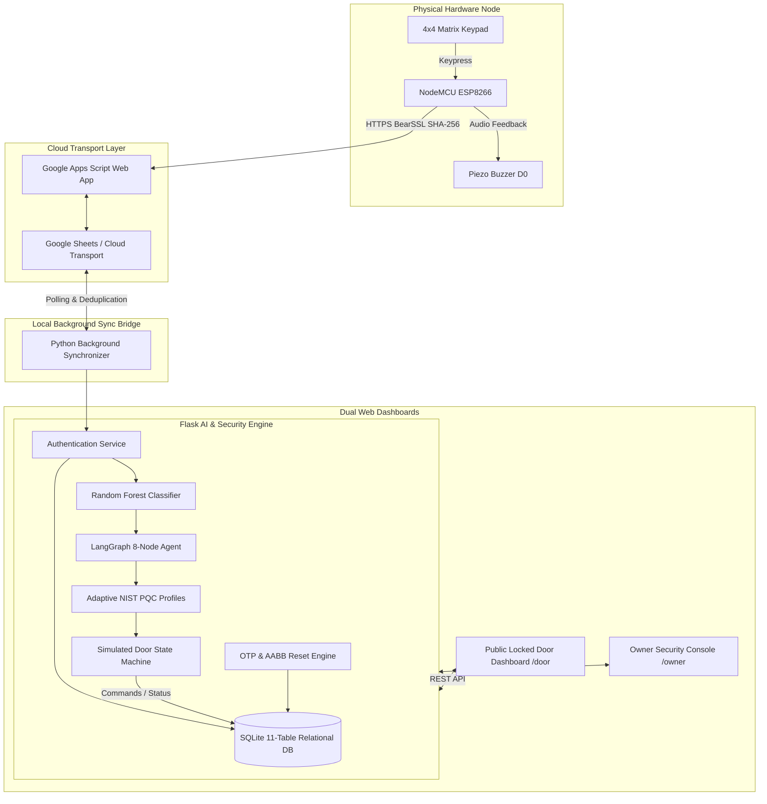

# Agentic AI-Driven Adaptive Post-Quantum Cryptography for IoT Smart Door Lock Security
> **Major Project Final Build** • IoT security prototype with NIST post-quantum cryptography profiles, an 8-node LangGraph agent, Random Forest risk classification, dual web dashboards, and NodeMCU ESP8266 integration.

---

## 📑 Table of Contents
1. [Executive Summary](#-executive-summary)
2. [End-to-End Architecture](#-end-to-end-architecture)
3. [Technology Stack](#-technology-stack)
4. [Dual Dashboard Interface](#-dual-dashboard-interface)
5. [Offline CICIoT CSV Assessment](#-offline-ciciot-csv-assessment)
6. [Hardware Node Configuration](#-hardware-node-configuration)
7. [Core AI & Cryptographic Subsystems](#-core-ai--cryptographic-subsystems)
   - [Random Forest Risk Classification](#1-random-forest-risk-classifier)
   - [LangGraph 8-Node Autonomous Security Agent](#2-langgraph-8-node-autonomous-agent)
   - [NIST Post-Quantum Cryptography Suite](#3-adaptive-nist-pqc-profiles)
   - [Cryptographic OTP & AABB Password Reset Engine](#4-cryptographic-otp--aabb-password-reset-engine)
8. [SQLite Relational Database Schema](#-sqlite-relational-database-schema)
9. [Installation & Setup Guide](#-installation--setup-guide)
10. [Running the Application](#-running-the-application)
11. [Automated Verification & Test Suite](#-automated-verification--test-suite)
12. [Known Limitations & Safety Notes](#-known-limitations--safety-notes)
13. [College Viva Voce Defense & Examiner Q&A](#-college-viva-voce-defense--examiner-qa)

---

## 🌟 Executive Summary

Traditional IoT access control systems rely on static cryptographic protocols (RSA/ECC) and deterministic rule-based authorization logic, rendering them vulnerable to:
1. **Quantum Computing Adversaries:** Harvest-Now-Decrypt-Later (HNDL) attacks breaking discrete logarithm and integer factorization schemes.
2. **Dynamic Attack Vectors:** Distributed brute-force attacks, timing analysis, and attempt bursts bypassing naive rate-limiting.
3. **Insecure Password Recovery:** Cloud-dependent insecure reset links prone to interception and replay.

This project delivers an **Autonomous, Quantum-Resistant, Adaptive Access Control Infrastructure**:
- **Dual Operating Surfaces:** Public simulated 3D door (`/door`) and an Authenticated Owner Security Operations Center (`/owner`).
- **NIST Post-Quantum Cryptography:** Dynamically scaled lattice-based algorithms (**ML-KEM** / FIPS 203 and **ML-DSA** / FIPS 204) across NIST Security Levels 1, 3, and 5.
- **Agentic AI Orchestration:** 8-node stateful **LangGraph** agent executing an autonomous `observe -> assess -> reassess -> plan -> decide -> act -> recommend -> reflect` cognitive loop.
- **Machine Learning Threat Detection:** 250-tree **Random Forest Classifier** trained on high-dimensional access telemetry (93.58% accuracy).
- **Physical Keypad Password Reset Flow:** `AABB` sequence detection on hardware with 2-minute cryptographic single-use OTP validation.
- **Relational Source of Truth:** Multi-table **SQLite** database operating with WAL mode, PBKDF2-HMAC-SHA256 password hashing, and zero plaintext secret leakage.

---

## 🏛️ End-to-End Architecture



---

## 🖥️ Dual Dashboard Interface

### 1. Public Locked Door Dashboard (`http://127.0.0.1:5000/door` or `/`)
- **3D Simulated Door Visualizer:** Interactive perspective-transformed door leaf with dynamic locking bolt and status illumination.
- **Access Control Terminal:** Virtual 4x4 matrix keypad supporting mouse, touch, and physical keyboard inputs.
- **Real-Time AI Pipeline Flow:** Dynamic node-by-node illumination of the 8 LangGraph stages during live authentication.
- **Live Agent Reasoning Stream:** Human-readable explanations of security evaluations, risk probabilities, and active PQC suites.
- **Hardware Telemetry Indicator:** Live online/offline status badge of the NodeMCU ESP8266 hardware node.

### 2. Owner Security Operations Console (`http://127.0.0.1:5000/owner`)
- **Authentication Barrier:** Owner APIs require an authenticated owner session. A new database creates the `admin` account using `OWNER_INITIAL_PASSWORD` from the local `.env` file.
- **Direct Actuator Override:** Instant remote manual lock and unlock controls for the simulated door.
- **Password Management & OTP Module:** Live 6-digit cryptographic reset OTP generator with 120-second active countdown timer and revocation controls.
- **Intrusion Risk Analytics:** Real-time risk distribution bar charts (LOW, MEDIUM, HIGH) and attempt velocity telemetry.
- **NIST PQC Suite Inspector:** Live profile comparator displaying active key encapsulation (ML-KEM) and digital signature (ML-DSA) algorithms.
- **Immutable Security Audit Log:** Tabular log of all access events, timestamps, source identifiers, truncated SHA-256 digests, decisions, and system alerts.

### Network Assessment History
The Public Door dashboard includes the persisted **Network Assessment History** table. It distinguishes offline/supplied CSV test results from live-capture prototype observations; authentication events remain separate and are not presented as packet observations. The table shows timestamp, device risk, network risk/attack, confidence when supplied by the model, final risk, selected PQC profile, and action status.

The CSV controls on the Public Door dashboard are for offline/supplied CICIoT test data. They do not start or represent live packet capture.

---

## 📈 Offline CICIoT CSV Assessment

The Public Door's **Network Assessment History** section supports testing one row from a local CICIoT CSV file without using the Owner Security Console.

### How to run an offline assessment
1. Open `http://127.0.0.1:5000/door`.
2. In **Network Assessment History**, choose a CICIoT CSV file.
3. Enter a positive data row number, excluding the header. The input defaults to row `106`.
4. Select **ANALYZE SELECTED CSV ROW**.
5. Read the result panel and confirm the new record appears at the top of the persisted history.

The interface labels these results as **offline/supplied CSV test data**. It reads only the selected row in the browser, checks that the header contains exactly the 39 expected feature names in the trained model's order, and rejects missing/non-numeric values or an out-of-range row. The backend validates the feature names and numeric values again before inference.

### Model pipeline and output
The backend uses `services.ciciot_classifier` and the existing CICIoT2023 Random Forest model plus its saved robust scaler. It does not synthesize predictions. Inputs are transformed with the saved scaler, then classified by the existing model. The result includes:
- Device risk and confidence.
- Network risk, predicted attack class, and model confidence when available.
- Final coordinated risk and the selected existing PQC profile.
- A unique decision ID, timestamp, and action status.

The current classifier maps `BenignTraffic` to LOW. Other predictions with confidence below `0.70` map to MEDIUM; other predictions at or above that threshold map to HIGH. Final risk and profile selection are produced by the existing agent pipeline.

Manual CSV analysis uses `POST /api/network/assess-offline`. This is intentionally distinct from the existing owner-authenticated `POST /api/network/analyze` route: the assessment-only route persists the actual decision and recommendation but does not execute it, change door state, activate lockout, or queue a hardware command. The action status is `ASSESSMENT_ONLY_NO_DOOR_ACTION`. The page refreshes persisted history immediately after success and polls for updated history periodically. `GET /api/network/assessments` returns the limited assessment fields used by that table.

### Dataset and model files
- Sample benign dataset: `ciciot_experiment/data/raw/BenignTraffic.pcap.csv`.
- Other CICIoT traffic CSVs are in `ciciot_experiment/data/raw/`.
- Network model artifact: `ciciot_experiment/models/ciciot_random_forest.pkl`.
- Network scaler artifact: `ciciot_experiment/data/processed/robust_scaler.pkl`.

Both model and scaler artifacts are required for network inference. The sample CSVs can be large; the browser streams the selected file and stops reading after it has obtained the requested row.

---

## 🔌 Hardware Node Configuration

### Microcontroller: NodeMCU ESP8266 (ESP-12E Module)
The door is strictly simulated in the web browser. The physical hardware consists of the NodeMCU microcontroller, 4x4 matrix keypad, and buzzer.

| Component | Pin Label | NodeMCU GPIO | Function / Mode |
| :--- | :--- | :--- | :--- |
| **Keypad Row 1** | `R1` | `GPIO 5` (`D1`) | Row Output Scanning |
| **Keypad Row 2** | `R2` | `GPIO 4` (`D2`) | Row Output Scanning |
| **Keypad Row 3** | `R3` | `GPIO 14` (`D5`) | Row Output Scanning |
| **Keypad Row 4** | `R4` | `GPIO 12` (`D6`) | Row Output Scanning |
| **Keypad Col 1** | `C1` | `GPIO 13` (`D7`) | Column Input (Pullup) |
| **Keypad Col 2** | `C2` | `GPIO 0` (`D3`) | Column Input (Pullup) |
| **Keypad Col 3** | `C3` | `GPIO 2` (`D4`) | Column Input (Pullup) |
| **Keypad Col 4** | `C4` | `GPIO 15` (`D8`) | Column Input (Pullup) |
| **Piezo Buzzer** | `+` | `GPIO 16` (`D0`) | Audio Tone Feedback |
| **Piezo Buzzer** | `-` | `GND` | Ground |

### Buzzer Acoustic Frequency Patterns:
- **Keypress:** Short chirp (40ms).
- **Authorized / Success:** Ascending double-tone (100ms on, 80ms off, 120ms on).
- **Access Denied:** Descending triple-tone (120ms on, 80ms off × 3).
- **High-Risk Lockout Alarm:** Continuous pulsed siren pattern (300ms on, 100ms off × 4).
- **Password Reset Mode Activated:** Dual warning tone (200ms on, 100ms off × 2).

---

## 🧠 Core AI & Cryptographic Subsystems

### 1. Random Forest Risk Classifier
The machine learning subsystem utilizes an ensemble of **250 randomized decision trees** trained on synthetic multidimensional access vectors:
- **Features Analyzed:** `failed_auth_attempts`, `successful_auth_attempts`, `attempt_velocity` (attempts / 30s), `communication_latency_ms`, `cpu_utilization`, `memory_usage`, `network_anomaly`, `threat_indicator`.
- **Classification Output:** Multi-class probabilities mapping to `LOW`, `MEDIUM`, or `HIGH` risk tiers.
- **Model Accuracy:** 93.58% test accuracy, evaluated with 5-fold stratified cross-validation.

### Network Risk Analysis Integration
The owner-authenticated `POST /api/network/analyze` endpoint accepts one JSON
object containing exactly the 39 CICIoT2023 numeric feature columns. The
network Random Forest prediction is fused conservatively with the device
Random Forest risk: the higher risk wins, so benign network traffic cannot
reduce a HIGH device risk. Missing network telemetry is reported as
`UNKNOWN` in device-only assessments; no network prediction is invented.

The owner-authenticated `POST /api/network/analyze` endpoint analyzes
owner-supplied flow features for testing/integration. It does not capture live
packets, and its request is deliberately not accepted by the ESP8266 or
PIN-authentication endpoints. This owner endpoint retains the existing
assessment/action policy: a HIGH combined assessment may activate the
lockout policy and queue a hardware `LOCKOUT` command. A queued command is
pending until acknowledged by the ESP8266 and is not proof of physical
actuation. MEDIUM assessments are recorded in the security audit trail.

For safe manual CSV tests from the Public Door, use the separate
`/api/network/assess-offline` assessment-only route described above. It does
not execute those recommended actions.

### 2. LangGraph 8-Node Autonomous Agent
The cognitive decision engine implements an 8-node directed acyclic state graph executing sequentially:

```
[1. OBSERVE] ➔ Telemetry ingestion & sliding window velocity analysis
     ↓
[2. ASSESS] ➔ Random Forest ML inference & class probability calculation
     ↓
[3. REASSESS] ➔ Threat indicator evaluation & progressive escalation rules
     ↓
[4. PLAN] ➔ PQC algorithm selection & defensive posture formulation
     ↓
[5. DECIDE] ➔ Binary access determination (ALLOW / DENY / LOCKOUT)
     ↓
[6. ACT] ➔ PQC key generation, simulated door actuation, command queueing
     ↓
[7. RECOMMEND] ➔ Automated administrative advisories & mitigation directives
     ↓
[8. REFLECT] ➔ Agent introspection, ML vs Agent agreement metrics, SQLite audit commit
```

### 3. Adaptive NIST PQC Profiles
In compliance with NIST Post-Quantum Cryptography Standardization (August 2024), the system dynamically scales cryptographic strength:

| Risk Tier | Security Profile | NIST Standard | Key Encapsulation (KEM) | Digital Signature (DSA) | Target Threat Scenario |
| :--- | :--- | :--- | :--- | :--- | :--- |
| **LOW** | Profile 1 | NIST Level 1 (AES-128 equivalent) | **ML-KEM-512** | **ML-DSA-44** | Normal verified owner access |
| **MEDIUM** | Profile 2 | NIST Level 3 (AES-192 equivalent) | **ML-KEM-768** | **ML-DSA-65** | Anomalous timing / isolated failure |
| **HIGH** | Profile 3 | NIST Level 5 (AES-256 equivalent) | **ML-KEM-1024** | **ML-DSA-87** | Brute-force burst / Intrusion lockout |

Profile selection is distinct from native cryptographic execution. When
`liboqs` is unavailable, the service reports `PROFILE_SELECTION_ONLY`; it does
not claim that ML-KEM or ML-DSA operations were performed.

### 4. Cryptographic OTP & AABB Password Reset Engine
To prevent unauthorized hardware credential modification:
1. **Sequence Trigger:** Keypad inputs `AABB` -> triggers `STATE_RESET_WAITING_OTP`.
2. **OTP Generation:** Owner accesses `/owner` -> clicks `GENERATE RESET OTP` -> system generates a 6-digit random code (`secrets.randbelow`) valid for exactly **120 seconds**. The OTP hash is committed to SQLite.
3. **Keypad Verification:** User enters 6-digit OTP on physical keypad or terminal -> verified against salted PBKDF2 hash. Maximum 3 incorrect attempts before session revocation.
4. **Atomic Password Update:** User enters and confirms new PIN (4-8 digits) -> password table version is incremented, old PIN is marked inactive, new PIN is active immediately.

---

## 🗄️ SQLite Relational Database Schema

The database (`backend/data/smart_door.db`) maintains 11 normalized relational tables:
1. `owners`: Administrative accounts (`username`, `password_hash`, `salt`, `status`).
2. `owner_sessions`: Cryptographic 24h bearer tokens (`session_token`, `owner_id`, `expires_at`).
3. `door_credentials`: Door PIN credentials with versioning (`credential_name`, `pin_hash`, `salt`, `version`, `is_active`, `user_alias`).
4. `devices`: Hardware telemetry and registration records (`device_id`, `ip_address`, `rssi`, `wifi_status`, `device_state`, `is_online`).
5. `authentication_events`: Access history (`source`, `attempted_hash`, `user`, `result`, `ml_risk`, `agent_risk`, `pqc_kem`, `action_taken`).
6. `security_events`: High-level alerts and subsystem telemetry (`severity`, `event_type`, `description`, `metadata_json`).
7. `risk_assessments`: ML and agent risk outputs (`ml_predicted_risk`, `agent_final_risk`, `attempt_velocity`).
8. `agent_decisions`: Comprehensive LangGraph execution traces (`reasoning_json`, `plan_json`, `recommendations_json`).
9. `commands`: Replay-protected command queue for hardware actuation (`command`, `risk_level`, `status`, `expires_at`).
10. `reset_sessions`: Multi-step password reset sessions (`session_id`, `otp_hash`, `salt`, `status`, `attempt_count`, `expires_at`).
11. `system_config`: Central key-value runtime configuration store (`config_key`, `config_val`).

---

## 🧰 Technology Stack

| Layer | Technologies |
| --- | --- |
| Backend/API | Python, Flask, Flask-CORS, LangGraph |
| Risk analysis | scikit-learn Random Forest, CICIoT2023 feature data |
| Persistence and authentication | SQLite, PBKDF2-HMAC-SHA256, Python `secrets` |
| Cryptography | liboqs-backed ML-KEM / ML-DSA when available; profile-selection fallback is reported explicitly |
| Web UI | HTML, CSS, JavaScript |
| Optional hardware/cloud bridge | ESP8266 Arduino firmware, Google Apps Script, Google Sheets |

## 🚀 Installation & Setup Guide

### Prerequisites
- Python 3.10 or newer (use the same Python installation for dependency setup and the Flask server)
- Arduino IDE (for NodeMCU ESP8266 firmware flashing)
- Modern Web Browser (Chrome / Edge / Firefox)

### Step 1: Install Python Dependencies
Run from the project directory that contains `backend`, `frontend`, and `ciciot_experiment`.

PowerShell:
```bash
Copy-Item .env.example .env
notepad .env
cd backend
py -3 -m venv .venv
.\.venv\Scripts\Activate.ps1
python -m pip install -r requirements.txt
```

In `.env`, replace every `replace-with-...` value with unique secrets, set different 4-8 digit initial PINs, and fill in the Windows computer's LAN IPv4 settings if using hardware. The first startup creates the initial `admin` owner and door credentials from these values. Do not commit `.env`.

If PowerShell blocks environment activation, run the environment's interpreter directly instead:
```bash
.\backend\.venv\Scripts\python.exe -m pip install -r .\backend\requirements.txt
```

The backend dependency file includes Scapy for the optional packet-capture prototype; the presence of Scapy alone does not guarantee that capture is available. On Windows, Npcap and appropriate interface permissions are also required. Capture is opt-in and not needed for the offline CSV assessment.

### Configuration
`ip\ipfile` is a sanitized template. Alternatively, set `FLASK_LAN_IP`, `FLASK_BACKEND_URL`, and `DEVICE_API_BASE_URL` in `.env` to the Windows computer's LAN IPv4 address. Configure Google Apps Script and Sheets values only if using that optional integration. `DATABASE_PATH` can point to a separate SQLite file for isolated local testing.

The existing model and scaler artifacts are expected at the paths listed in the dataset/model section. The normal assessment workflow uses the existing files; do not retrain or replace them just to run the application.

### Step 3: Flash NodeMCU ESP8266 Firmware (Optional for Hardware Node)
1. Open Arduino IDE.
2. Install `esp8266` board support via Board Manager (`Tools > Board > Boards Manager > esp8266`).
3. Install `Keypad` library via Library Manager (`Sketch > Include Library > Manage Libraries... > Keypad`).
4. Open `esp8266/smart_door_esp8266_all_in_one/smart_door_esp8266_all_in_one.ino`.
5. Replace the firmware's Wi-Fi placeholders, API URL, and device token locally. Use the same random `DEVICE_SECRET` in the firmware and the project's ignored `.env`; never commit your real values.
6. Select Board: `NodeMCU 1.0 (ESP-12E Module)`, Port: COM port of ESP8266.
7. Click **Upload**.

---

## 🏃 Running the Application

### 1. Start the Flask Backend Server
From the project root:
```bash
cd backend
.\.venv\Scripts\python.exe app.py
```
If you are using an activated environment, run `python app.py`. The default local address is `http://127.0.0.1:5000`; `FLASK_PORT` or `PORT` can change the port.

### 2. Start the Google Sheets Background Synchronizer (Optional)
Configure `GOOGLE_SCRIPT_URL`, `GOOGLE_SPREADSHEET_ID`, and `GOOGLE_DEVICE_TOKEN` in `.env`, and set the matching `DEVICE_TOKEN` in Google Apps Script project properties before enabling this integration.
```bash
cd backend
.\.venv\Scripts\python.exe sync_google_sheets.py --interval 3
```

### 3. Access the Dashboards
- **Public Locked Door Dashboard:** Open [http://127.0.0.1:5000/door](http://127.0.0.1:5000/door)
- **Owner Security Console:** Open [http://127.0.0.1:5000/owner](http://127.0.0.1:5000/owner) and sign in as `admin` using the `OWNER_INITIAL_PASSWORD` configured in `.env` before the first database initialization.

---

## 🧪 Automated Verification & Test Suite

Run the tests from the `backend` directory using the same Python environment as the application.

Focused test for the offline assessment-only feature (uses isolated temporary SQLite storage and real CICIoT dataset rows):
```bash
python -m unittest tests.test_offline_assessment_only -v
```

The focused offline test checks LOW, MEDIUM, and HIGH model samples, actual prediction and confidence fields, persistence and history retrieval, input-schema rejection, and that assessment-only requests do not alter door/lockout state or enqueue commands. It also verifies that the separate owner-only analysis route remains protected. It requires the dataset and CICIoT model/scaler artifacts to be present.

To run all backend tests (from the `backend` directory):
```bash
python -m unittest discover -s tests -t . -p "test_*.py" -v
```

The test package supplies disposable test-only credentials and an isolated temporary database; the suite does not touch your local `.env` database.

Tests for live capture use mocked interfaces/packets and should not be interpreted as proof that a real machine has Npcap, permissions, a usable interface, or training-compatible live model features.

---

## ⚠️ Known Limitations & Safety Notes
- Offline CSV evaluation is not live packet capture. The selected file and row are supplied test data.
- The model accepts the CICIoT2023 flow feature schema; packet metadata alone is not automatically treated as a valid 39-feature sample.
- Live packet capture is opt-in, owner-controlled, time-limited, and stoppable. Do not enable it unless you are authorized to monitor the selected interface. The dashboard reports unavailable/unsupported states when prerequisites or model compatibility are missing.
- The assessment-only CSV route persists decisions but does not issue door, lockout, or hardware actions. This does not change the separate authentication and owner network-analysis policies.
- The simulated door and ESP8266 hardware integration are separate components. A queued device command is not confirmation that physical hardware executed it.
- This project is a demonstration/prototype, not a production security certification. Review authentication defaults, secrets, network exposure, hardware safety, and dependency versions before any deployment.
- Local `.env` files, SQLite databases, event/agent state, generated risk data, and logs are excluded from Git. The CICIoT datasets and associated model artifacts are included through Git LFS.

---

## 🎓 College Viva Voce Defense & Examiner Q&A

### Q1: Why is Post-Quantum Cryptography needed for an IoT smart door lock?
> **Answer:** Standard public-key cryptography (RSA and ECC) depends on mathematical problems like integer factorization and discrete logarithms, which can be solved in polynomial time by Shor's Algorithm on a fault-tolerant quantum computer. Adversaries are currently executing "Harvest-Now-Decrypt-Later" (HNDL) attacks—intercepting and storing encrypted IoT communications today to decrypt them once quantum hardware matures. Our system implements NIST FIPS 203 (ML-KEM) and FIPS 204 (ML-DSA) lattice-based cryptography to guarantee long-term forward secrecy against both classical and quantum adversaries.

### Q2: Why is the AI split into a Random Forest Classifier AND a LangGraph Agent?
> **Answer:** The two AI systems serve distinct complementary roles:
> 1. **Random Forest Classifier (Statistical Perception):** Performs ultra-fast, microsecond-level statistical inference on continuous telemetry vectors (failed attempt streaks, velocity, system metrics) to output calibrated risk probabilities.
> 2. **LangGraph Agent (Cognitive Orchestration):** Executes a deterministic 8-node state machine that contextualizes the ML output, evaluates progressive escalation rules, determines the exact PQC profile, triggers autonomous physical actions (lockout, alert, unlock), and performs self-reflective reasoning. This separation gives us both high-speed perception and explainable, auditable autonomous decision-making.

### Q3: How does the password reset flow prevent unauthorized physical resets?
> **Answer:** Traditional IoT reset buttons or hardcoded sequences are vulnerable to anyone with physical access. Our system implements a 2-factor physical-digital protocol:
> 1. The user keys `AABB` on the physical keypad to place the lock in reset mode.
> 2. The lock *cannot* be reset without a 6-digit cryptographic OTP generated by the authenticated owner in `/owner`.
> 3. The OTP is time-bounded (120 seconds TTL), single-use, rate-limited (max 3 tries), and verified against a salted PBKDF2 hash.

### Q4: How is security maintained across Google Sheets and the ESP8266?
> **Answer:** 
> 1. **Zero Plaintext Secrets:** The ESP8266 calculates BearSSL SHA-256 hashes locally on the microcontroller before transmitting over Wi-Fi. Plaintext PINs never traverse the network or appear in Google Sheets.
> 2. **Transport Layer Only:** Google Sheets acts purely as an asynchronous message queue, not the security authority. The Python backend is the sole source of truth and performs all authentication against SQLite.
> 3. **Idempotency & Replay Protection:** Every event has a unique cryptographic `event_id` and timestamp; duplicates are rejected by the synchronizer.

---
